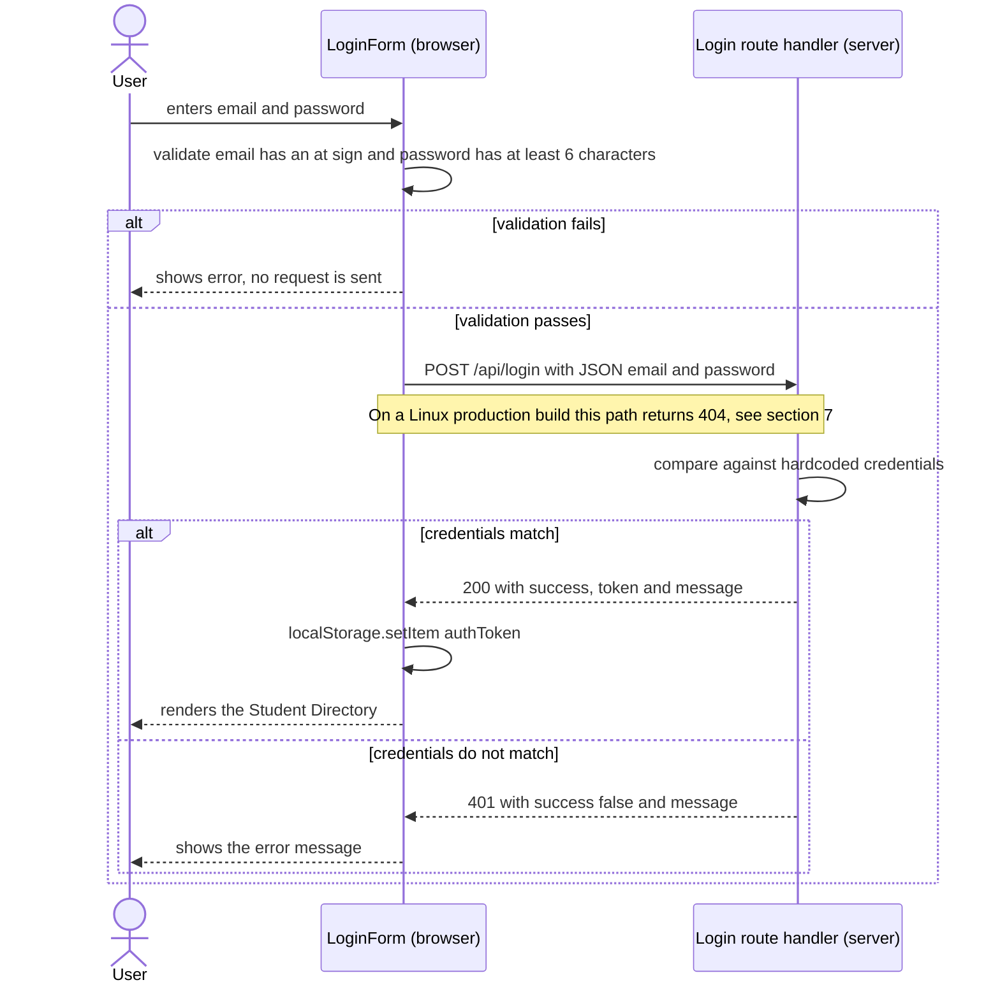
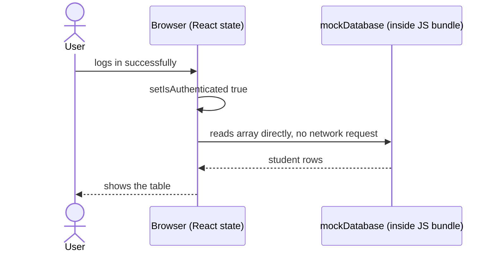
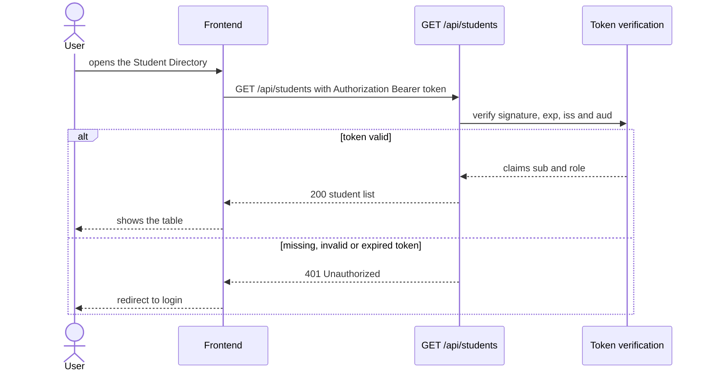
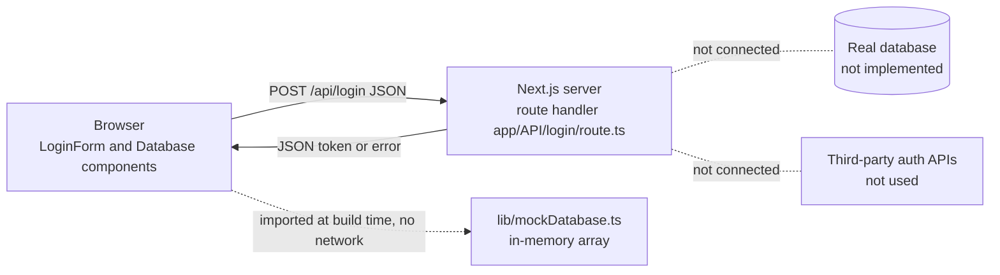

# Authentication Report — PaginaRamses

| | |
|---|---|
| **Repository** | https://github.com/mauroDev98/PaginaRamses |
| **Commit analysed** | `cf0f187` (branch `main`) |
| **Stack** | Next.js 16.2.7 (App Router), React 19.2.4, TypeScript |
| **Report date** | 2026-11-03 |
| **Authors** | `MAURO RIVERO FRANCO / RENE TREJO BORUNDA / YADIER GONZALEZ FLORES / JOHAN BERTRAND` |

## Summary

The project implements authentication as a **teaching simulation of a client–server login with a bearer token**. The login endpoint is *our own* (a Next.js route handler, not a separate microservice and not a third-party provider). It checks a hardcoded credential pair and returns a **fixed, unsigned string** that looks like a JWT. The browser stores that string in `localStorage`.

This report documents what the code **really does** (verified by reading the source and by running the production build, see section 7), and for each section it also states what a production-grade version would need. Where the current behaviour is a gap, it is labelled **Gap** so that the distinction between *implemented* and *recommended* is always clear.

Key findings, in order of severity:

1. **Access control is not enforced by the server.** The whole student dataset ships inside the public JavaScript bundle; the "login gate" is only a React state variable.
2. **The token is never verified.** No endpoint receives or checks it, and it has no signature, claims or expiry.
3. **Hardcoded credentials, no rate limiting.** Eight consecutive failed logins were all answered `401` without any slowdown or lockout.
4. **Route-name mismatch.** The handler is registered as `/API/login` but the frontend calls `/api/login`; on a Linux production build this returns `404`.
5. **Dependency risk.** `npm audit` flags `next@16.2.7` as critical (patched in `16.4.5`).

---

## 1. Mechanism

**What is used:** a *bearer-token* scheme in the style of JWT, issued by a first-party endpoint (`POST` route handler in `app/API/login/route.ts`).

| Aspect | Current implementation |
|---|---|
| Credential check | Server compares `email` and `password` with a hardcoded pair (`route.ts`, line 9) |
| Token type | JWT-looking string `mock_jwt_abc123.def456.ghi789` (line 14) — **three dot-separated segments but not a real JWT**: not Base64URL-encoded JSON, no signature |
| Token storage | `localStorage` key `authToken` (`LoginForm.tsx`, line 38) |
| Sessions / OAuth 2.0 | Not used |
| Third-party providers | None (no Auth0, Firebase, Google Sign-In) |

**Why this approach.** It makes every step of authentication visible and runs with zero external accounts, cost or configuration, which suits a course project whose goal is to understand the request/response cycle: frontend validation → HTTP call → server verification → token returned → client stores it.

**Own vs third-party — trade-offs**

| | Own authentication (this project) | Third-party (Auth0, Firebase, Google Sign-In) |
|---|---|---|
| **Pros** | Full control and visibility; no vendor lock-in; no external dependency or cost; ideal for learning | Battle-tested password storage, MFA, brute-force protection, token rotation, social login; far less security code to maintain |
| **Cons** | Every security feature must be built and maintained by the team; easy to get subtly wrong (hashing, token lifecycle, rate limiting) | Vendor dependency and possible cost; outage of the provider affects login; less visibility into internals; data leaves your infrastructure |
| **Fit here** | Appropriate as a learning simulation | Recommended if the app ever handles real users |

---

## 2. Flow

### 2.1 Login (as implemented)



Frontend validation (`LoginForm.tsx`, lines 17–23) only saves round-trips; it is **not** a security control, because anyone can call the endpoint directly.

### 2.2 Protected request

**Gap — there is no protected request in the current code.** After login the browser only flips a React state (`isAuthenticated`) and renders `Datatable`, which reads `mockDatabase` from a module bundled in the client JavaScript. No second HTTP request is made and the token is never sent.

What happens today:



Recommended design for a real protected request:



---

## 3. Token / session

### Current behaviour

| Property | Value today |
|---|---|
| Format | Constant string `mock_jwt_abc123.def456.ghi789` |
| Claims | **None** — the string carries no user id, role, issuer or audience |
| Signature | **None** |
| Expiry (`exp`) | **None** — never expires |
| Renewal | **None** |
| Logout | **None** — there is no logout button and nothing removes `authToken` |
| Persistence | Token is written to `localStorage` but **never read back**. `isAuthenticated` starts as `false` (`useState(false)`), so a page reload shows the login form again |

### Recommended strategy (not implemented)

| Property | Recommendation |
|---|---|
| Format | Signed JWT (e.g. HS256 with a secret from an environment variable, or ES256/RS256), created and verified with a maintained library such as `jose` |
| Claims | `sub` (user id), `role`, `iat`, `exp`, `iss`, `aud` — nothing sensitive (JWT payloads are readable by anyone) |
| Access-token expiry | Short, e.g. 15 minutes |
| Renewal | Refresh token (e.g. 7 days) in an `HttpOnly; Secure; SameSite=Lax` cookie, rotated on every use; `/api/refresh` issues a new access token |
| Logout | `/api/logout` clears the cookie and revokes the refresh token server-side; the client discards the access token from memory |
| Storage | Access token in memory, refresh token in `HttpOnly` cookie — **not** `localStorage`, which any injected script can read |

---

## 4. Architecture



The "auth service" is not a separate component: it is a single route handler running in the same Next.js process as the frontend.

| From → To | Endpoint / mechanism | Data |
|---|---|---|
| Browser → Server | `POST /api/login` (as called by `LoginForm.tsx`; registered as `/API/login`) | Request: `{ email, password }` (JSON) |
| Server → Browser | HTTP response | `200 { success, token, message }` · `401 { success: false, message }` · `500 { message }` |
| Browser → mock data | None (static `import` of `lib/mockDatabase.ts`) | Student rows `{ id, name, major, grade }` bundled into a public JS chunk |
| Server → Database | **None** | Credentials are literals in the code |
| Server → Third-party API | **None** | — |
| Browser → Protected API | **None (Gap)** | The token is never transmitted after login |

---

## 5. Failure

| Failure | What happens today | What should happen (production) |
|---|---|---|
| **Auth service down** | The login endpoint lives in the same process as the app, so if it is down the whole site is down. If only the route fails, the form shows the server's message (`500`) or "Failed to communicate with the server" (network error or non-JSON response, e.g. an HTML `404` page; expected from the code path, not separately tested). Users already inside are **not** affected, because the table does not depend on the server | Fail **closed**: no login, no data. Return `503` with a clear message; keep health checks and alerts |
| **Database down** | Not applicable: there is no database. The mock array is bundled with the client, so it cannot fail — which is also why it cannot be protected | Login returns `503` (never "success"); already-issued access tokens keep working until they expire if they are verified locally (stateless JWT) |
| **Third-party API down** | Not applicable: none is used | With Auth0/Google/Firebase: new logins unavailable; existing JWTs still validate locally while the provider's public keys (JWKS) are cached; show a clear error and optionally fall back to a secondary login method |

Important consequence of the current design: a failure of the auth component **does not protect the data**, because the data is delivered to every visitor regardless of login (see 6, A01).

---

## 6. Security

### Measures applied

- Generic error message (`Invalid credentials`) that does not reveal whether the email exists.
- Password field uses `type="password"`.
- Endpoint answers only `POST`; `GET` returns `405` (verified).
- `try/catch` returns a generic `500` without stack traces.
- Basic client-side validation (UX only).
- `package-lock.json` is committed, giving reproducible installs.

### OWASP Top 10:2025 mapping

| ID | Category | Observation in this project | Risk | Recommended fix |
|---|---|---|---|---|
| **A01:2025** | Broken Access Control | The full student dataset is in a public JS chunk (verified under `.next/static`). The gate is only client state, so it is bypassable. No server-side authorization or roles | **High** | Move data behind a server route that verifies the token and returns data only to authorised roles; never import data into client components |
| **A02:2025** | Security Misconfiguration | No security headers on responses (no CSP, HSTS, `X-Frame-Options`, `X-Content-Type-Options` in the observed headers). Demo credentials are printed on the login page as a hint. Route case mismatch (`/API` vs `/api`) | Medium | Set headers in `next.config.ts`; remove the hint in production; rename the folder to `app/api` |
| **A03:2025** | Software Supply Chain Failures | Few direct dependencies (`next`, `react`, `react-dom`), lockfile present. But `npm audit --omit=dev` (2026-11-03) reports **6 vulnerabilities (1 critical, 4 high, 1 moderate)**; the critical one is `next@16.2.7`, patched in `16.4.5`. One advisory concerns middleware/proxy bypass with Turbopack — relevant if middleware is later used for auth | **High** | Upgrade Next.js to the patched version; run `npm audit` in CI; enable Dependabot |
| **A04:2025** | Cryptographic Failures | Token is unsigned; password compared as plain text against a literal; no hashing; local dev runs over HTTP | **High** | Hash passwords (Argon2/bcrypt) in a real store; sign tokens with a secret from env vars; enforce HTTPS (provided automatically if deployed on Vercel) |
| **A05:2025** | Injection | No database, shell or template engine, so no injectable sink today; React escapes rendered output. Request body fields are used without type validation | Low (today) | Validate input with a schema (e.g. `zod`); use parameterised queries when a database is added |
| **A06:2025** | Insecure Design | Authentication is designed as a simulation: one shared account, no registration, no roles, no token lifecycle, no threat model | Medium | Define roles, token lifecycle and trust boundaries before building; document in this report |
| **A07:2025** | Authentication Failures | Hardcoded credentials; **no rate limiting or lockout** (8 consecutive wrong passwords all returned `401`, verified); no MFA; no expiry or logout; token in `localStorage`; 6-character minimum enforced only in the browser | **High** | Rate limit and lock out; enforce password policy server-side; `HttpOnly` cookies; token expiry and logout; MFA for sensitive roles |
| **A08:2025** | Software or Data Integrity Failures | Token integrity is not enforced because nothing verifies it: any string would be "accepted" by a future endpoint that only checks presence. No CI integrity checks | Medium | Verify signature, `exp`, `iss`, `aud` on every protected request; add CI checks |
| **A09:2025** | Security Logging and Alerting Failures | Failed and successful logins are not logged; the `catch` block discards the error; no alerting on brute-force | Medium | Log login attempts (never the password or token) with timestamp and IP; alert on bursts of failures |
| **A10:2025** | Mishandling of Exceptional Conditions | Malformed JSON returns **`500`** (should be `400`) — verified; error details are swallowed; a `404` HTML page is parsed as JSON on the client and ends in a generic message | Low–Medium | Return `400` for bad input, validate fields, handle non-JSON responses explicitly, log the cause |

### Remaining risks (priority order)

1. Data exposure through the client bundle (A01).
2. Unauthenticated brute force and hardcoded credentials (A07, A04).
3. Vulnerable Next.js version (A03).
4. Token has no signature, expiry or verification (A04, A08).
5. Missing logging and security headers (A09, A02).

---

## 7. Evidence

Executed on 2026-11-03 against commit `cf0f187`, Linux, production build (`npx next build` + `npx next start -p 3100`). Real passwords are redacted below.

### Build output (registered routes)

```
Route (app)
┌ ○ /
├ ○ /_not-found
└ ƒ /API/login
```

The handler is registered with uppercase `API`, while the frontend calls `/api/login`.

### Endpoint tests

| # | Request | Result |
|---|---|---|
| 1 | `POST /api/login` (path the frontend uses), valid demo credentials | **HTTP 404** |
| 2 | `POST /API/login`, valid demo credentials | **HTTP 200** `{"success":true,"token":"mock_jwt_abc123.def456.ghi789","message":"Login successful"}` |
| 3 | `POST /API/login`, wrong password | **HTTP 401** `{"success":false,"message":"Invalid credentials"}` |
| 4 | `POST /API/login`, malformed JSON body | **HTTP 500** `{"message":"Internal server error"}` |
| 5 | `GET /API/login` | **HTTP 405** |
| 6 | 8 consecutive wrong passwords | `401 401 401 401 401 401 401 401` (no rate limiting) |
| 7 | Search for a student name in `.next/static` | Found in `.next/static/chunks/*.js` (data is public) |
| 8 | Response headers of a `401` | Only `vary`, `content-type`, `Date`, `Connection`, `Keep-Alive`, `Transfer-Encoding` — no security headers |

### Dependency audit

```
npm audit --omit=dev   (2026-11-03)
6 vulnerabilities (1 moderate, 4 high, 1 critical)
next 16.2.7 -> critical, fix available: next@16.4.5
```

### How to reproduce

```bash
git clone https://github.com/mauroDev98/PaginaRamses && cd PaginaRamses
npm ci
npx next build
npx next start -p 3100

# in another terminal (replace the placeholders; do not commit real credentials)
curl -i -X POST http://localhost:3100/API/login \
  -H "Content-Type: application/json" \
  -d '{"email":"<demo-email>","password":"<demo-password>"}'
```

### Screenshots

> **TODO before submitting:** add screenshots to `docs/img/` and reference them here. Suggested set: (1) login form, (2) successful login showing the Student Directory, (3) the `401` error message after a wrong password, (4) browser DevTools → Application → Local Storage showing `authToken`. Do **not** capture the real password field or any personal data; crop or blur if needed.

---

## Recommended next steps

1. Rename `app/API` to `app/api` (on case-insensitive systems use two steps: `git mv app/API app/api-tmp && git mv app/api-tmp app/api`) and re-test the login from the browser.
2. Upgrade `next` to `16.4.5` or later and re-run `npm audit`.
3. Add a protected `GET /api/students` route and stop importing `mockDatabase` in client components.
4. Replace the fixed string with a signed JWT (`jose`), with `exp` and a refresh/logout flow.
5. Add rate limiting, server-side validation and login logging.

## Sources

- OWASP Top 10:2025 category list: https://top10.owasp.org/2025/ (codes A01–A10 checked on the official site's Portuguese edition; the English titles used above are the standard names, so confirm them on the English page before submitting)
- Project source files analysed: `app/API/login/route.ts`, `components/LoginForm.tsx`, `components/Database.tsx`, `lib/mockDatabase.ts`, `package.json`
